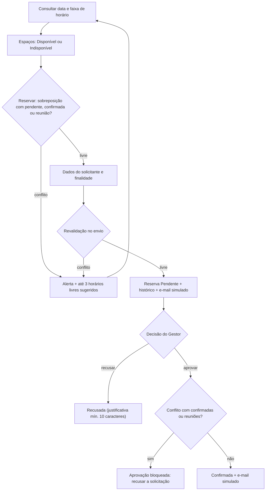
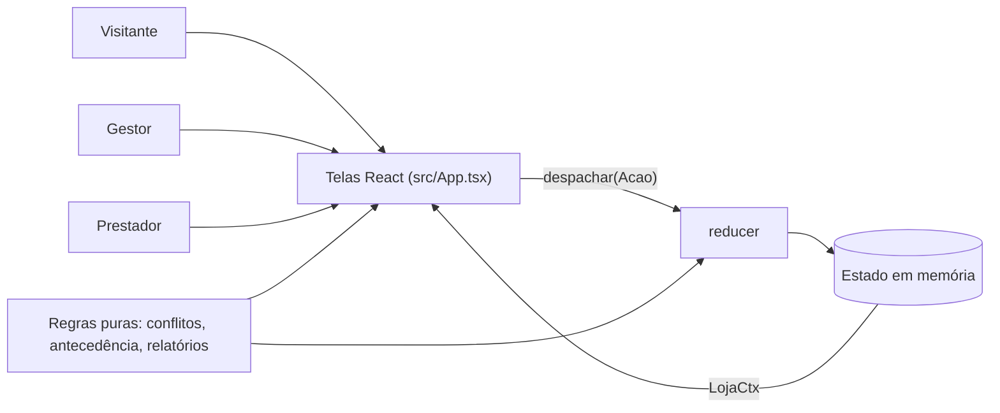

# InPETU Hub — MVP de CRM para gestão de espaços, visitas técnicas e chamados

**Demo:** <https://inpetu-hub.netlify.app/> · **Repositório:** <https://github.com/htklucas/inpetu-hub>

Protótipo funcional (SPA, sem backend) do Projeto Aplicado I — Análise e Desenvolvimento de Sistemas, Faculdade de Tecnologia SENAI (turma 494621, 2026/02).

---

## 1. Visão geral

**Problema.** O InPETU Hub (Centro de Inovação, Pesquisa, Empreendedorismo e Tecnologia da UFSC, no Sapiens Parque, Florianópolis) gerencia salas, auditório, atendimentos e visitas técnicas de forma manual e descentralizada (e-mail, WhatsApp e planilhas). Consequências: retrabalho, conflitos de agenda e ausência de visão gerencial.

**Solução.** Aplicação web que centraliza o fluxo *solicitação → aprovação → acompanhamento* em uma única fonte de estado, com prevenção de conflito de horário.

| Perfil | Acesso | Escopo |
| --- | --- | --- |
| Visitante (Empreendedor, Residente, Visitante, Instituição) | Sem login | Reservar espaço, solicitar visita técnica, abrir chamado, consultar solicitações pelo e-mail |
| Gestor do Hub | Login | Aprovar/recusar reservas e visitas; gerir espaços, solicitantes, chamados, agenda e relatórios |
| Prestador de Serviço/Técnico | Login | Atualizar o status dos chamados encaminhados pelo Gestor |

- **Natureza do código:** demonstração com dados fictícios. O estado vive em memória (`useReducer`); recarregar a página restaura os exemplos. E-mails, upload de fotos e relatórios são simulados.
- **Fora do escopo (ERE §1.2):** pagamentos, aplicativo móvel nativo, integração com Google Calendar/Outlook.
- **Equipe:** André Maciel Tratz, Lucas Josué Maia, João Henrique Espindola Dalfovo, Agustin Emanuel Fernandez.
- **Orientadora:** Milena Veiga · **Coorientação:** Luciano Costa, Gustavo Cantarelli, Rayse Souza.
- **Fontes de requisitos:** *Documento de Requisitos (ERE)* e *Plano de Trabalho Discente* do projeto.

---

## 2. Funcionalidades e regras de negócio

### 2.1 Mapeamento requisitos → código

Todos os símbolos estão em `src/App.tsx`.

| Funcionalidade | Código | ERE | Comportamento implementado |
| --- | --- | --- | --- |
| Cadastro e gestão de espaços | `GestorEspacos`, `EspacoFormulario`, `espaco/salvar`, `espaco/ativo` | RF01, RN04, RN05, UC01 | Nome, tipo (5), capacidade 1–1000, descrição, recursos (7), até 6 fotos (só nomes de arquivo; upload simulado), ativar/inativar. Inativo aparece como *Indisponível* e preserva o histórico |
| Consulta de disponibilidade | `ReservaPasso1`, `espacoDisponivel` | RF02, UC02 | Data (não pode ser passada) e faixa 07:00–22:00 em passos de 30 min, duração de 30 min a 12 h. *Disponível* = espaço ativo sem bloqueio confirmado na faixa. Acessível também ao Visitante (o ERE restringe a gestores autenticados) |
| Bloqueio de sobreposição | `sobrepoe`, `temConflito`, `sugerirHorarios` | RF03, RN01 | Intervalo semiaberto `[início, fim)`: encostar não conflita. No pedido bloqueiam reservas Pendentes e Confirmadas e reuniões internas. Sugere até 3 horários livres de mesma duração (grade de 1 h, 08:00–18:00). Revalida no envio e na aprovação |
| Solicitação de reserva | `ReservaPasso1`–`ReservaConfirmacao`, `reserva/criar` | RF04, RN02, UC03 | 3 passos. Cria reserva `Pendente`, grava histórico, dispara e-mail simulado e cadastra o solicitante se o e-mail for novo. Capacidade excedida gera alerta sem bloquear o envio (`BLOQUEAR_CAPACIDADE = false`) |
| Fila de aprovação | `GestorFila`, `ModalRecusa`, `reserva/decidir` | RF05, RN02, UC04 | Aprovar ou recusar. A aprovação revalida conflito (confirmadas e reuniões). A recusa exige justificativa (mín. 10 caracteres), com motivo sugerido para capacidade insuficiente. Indicadores: Pendentes, Confirmadas no mês, Espaços ativos |
| Cadastro de solicitantes | `GestorSolicitantes`, `SolicitanteFormulario` | RF06, UC05 | Tipos Empreendedor, Residente, Visitante, Instituição; e-mail único; busca por nome, e-mail ou empresa |
| Visita técnica | `VisitaForm`, `antecedenciaOk`, `visita/criar` | RF07, RN03, UC07 | Antecedência mínima de 3 dias úteis (sábado e domingo excluídos; `FERIADOS` vazia); duração fixa de 90 min. O texto de RF07 diz "3 dias"; RN03 ("dias úteis") prevalece |
| Agenda de visitas | `GestorVisitas`, `conflitoAgenda`, `itensDaSemana` | RF09, UC08 | Agenda semanal (seg.–sex.) com reuniões internas, reservas e visitas. A aprovação é bloqueada se a visita sobrepõe reunião interna ou visita já confirmada; a recusa exige justificativa |
| Perfis e acesso | `Cabecalho`, `autenticar`, `perfilDoHash` | RF10, RNF05 | 3 perfis fixos; Gestor e Prestador exigem login (contas de demonstração validadas no cliente). Não há tela para administrar permissões |
| Chamados | `ChamadoForm`, `GestorChamados`, `PrestadorChamados`, `ModalStatus` | Backlog Sprint 3, UC06, UC09 | Abertura sem login (5 categorias, espaço opcional), numeração sequencial, encaminhamento a prestador, status `Aberto → Em andamento → Resolvido → Fechado` (o modal sugere o próximo; aceita qualquer status diferente do atual), histórico e e-mail simulado |
| Relatórios | `GestorRelatorios`, `calcularRelatorio` | Backlog Sprint 4, UC10 | Filtros por mês inicial/final e espaço; indicadores (reservas confirmadas, visitas, chamados, horas reservadas), ranking de espaços e tabela mensal |
| Histórico | `Historico`, `registrar`, `ModalHistorico` | RNF04 | Cada mudança de status grava autor (Gestor, Prestador, Sistema), origem, destino e nota |
| Acompanhamento sem conta | `MinhasSolicitacoes` | RF04 (pós-condição) | Busca por e-mail lista reservas, visitas e chamados com status e justificativa de recusa |
| Acessibilidade | `Modal`, `isolarModal`, `focarPrimeiroErro`, link "Pular para o conteúdo" | — | Modais com `role="dialog"`, foco preso, fechamento por `Esc` e fundo `inert`; foco no primeiro campo inválido; layout responsivo com área segura (safe-area) |

- **Backlog (ERE §5):** histórias das Sprints 1–4 implementadas em forma de protótipo, exceto a definição de perfis pelo Gestor (perfis são fixos no código).
- **Plano de Trabalho §7.2:** espaços, agendamento (reservas e visitas) e atendimento/cadastro do empreendedor cobertos. "Controle de serviços internos e externos" (desejável) coberto apenas pela central de chamados e prestadores.
- **Rastreabilidade do ERE:** o Quadro 4 não define RF08, e o Quadro 13 cita RF07, RF08, RF10 e RF11 com numeração divergente. O mapeamento acima usa a descrição funcional e os UC.

### 2.2 Regras de negócio e parâmetros

| ID | Regra (ERE) | Implementação |
| --- | --- | --- |
| RN01 | Sem reservas sobrepostas no mesmo espaço | `temConflito`: no pedido, pendentes + confirmadas + reuniões; na aprovação, confirmadas + reuniões |
| RN02 | Reserva depende de aprovação do Gestor | Status inicial `Pendente`; decisão (`reserva/decidir`) exposta apenas na área do Gestor |
| RN03 | Visita com antecedência mínima de 3 dias úteis | `primeiraDataVisita()` = hoje + 3 dias úteis (14/10/2026 → 19/10/2026) |
| RN04 | Só o Gestor cadastra, edita ou inativa espaços | Aba *Espaços* disponível apenas na sessão do Gestor |
| RN05 | Espaço inativo não recebe pedidos e mantém histórico | `espacoDisponivel` exige `ativo`; botão *Reservar* desabilitado; reservas e relatórios preservados |

| Constante | Valor | Efeito |
| --- | --- | --- |
| `ANTECEDENCIA_VISITA_DIAS_UTEIS` | `3` | RN03 |
| `DURACAO_VISITA_MIN` | `90` | Término da visita = início + 90 min |
| `BLOQUEAR_CAPACIDADE` | `false` | `true` impede o envio acima da capacidade |
| `FERIADOS` | `[]` | Datas `aaaa-mm-dd` excluídas dos dias úteis |
| `JANELA_SUGESTOES` | 08:00–18:00, passo 60 min, máx. 3 | Grade de horários sugeridos |
| `VITE_HOJE_SIMULADO` | `2026-10-14` | "Hoje" da demonstração (ver §4) |



Visitas seguem o mesmo ciclo `Pendente → Confirmada | Recusada`, com a checagem de `conflitoAgenda` na aprovação.

### 2.3 Aderência aos requisitos não funcionais

| RNF | Parâmetro (ERE) | Situação no código |
| --- | --- | --- |
| RNF01 Usabilidade | Reserva em até 3 telas | Atendido: `PASSOS_RESERVA` (Espaço e horário → Seus dados → Confirmação) |
| RNF02 Desempenho | Disponibilidade em até 2 s | Cálculo síncrono em memória, sem rede; sem medição automatizada |
| RNF03 Confiabilidade | Fonte única de verdade | Parcial: estado único (`useReducer`), porém volátil |
| RNF04 Auditabilidade | Histórico por no mínimo 12 meses | Parcial: histórico de status por reserva, visita e chamado, mantido só na sessão |
| RNF05 Segurança | Autenticação e controle de acesso | Parcial: login de Gestor e Prestador no cliente (contas de demonstração); Visitante sem login, conforme pré-condições de RF03/RF04 |
| RNF06 Compatibilidade | Chrome e Edge recentes | SPA web padrão; sem testes de navegador no repositório |
| RNF07 Disponibilidade | 95 % em horário comercial | Hospedagem estática no Netlify; sem monitoramento ou SLA configurado |
| RNF08 Manutenibilidade | Princípios de POO | Parcial: tipos TypeScript, funções puras e reducer (paradigma funcional, sem classes); código em arquivo único |

### 2.4 Limitações conhecidas

- Sem backend, banco de dados ou persistência. O Plano de Trabalho (§7.3) prevê MySQL e back-end orientado a objetos, que não fazem parte deste repositório.
- Autenticação simulada. A consulta "Suas solicitações" não verifica a titularidade do e-mail informado.
- Relatórios usam base fictícia (jul–out/2026) somada às ações da sessão. A tela cita as views `vw_uso_espacos` e `vw_volume_mensal` como origem prevista dos dados no sistema com banco.
- Reuniões internas existem apenas como dados de exemplo (`RI-1`, `RI-2`); não há cadastro na interface.
- Feriados não entram no cálculo de dias úteis (`FERIADOS = []`).
- Sem testes automatizados nem linter; a verificação de tipos é feita por `npm run typecheck`.

---

## 3. Stack tecnológica e pré-requisitos

| Camada | Tecnologia | Declarado (`package.json`) | Resolvido (`package-lock.json`) |
| --- | --- | --- | --- |
| UI | React e React DOM | `^19.0.0` | 19.3.1 |
| Ícones | lucide-react | `^0.468.0` | 0.468.0 |
| Estilo | Tailwind CSS + `@tailwindcss/vite` (sem `tailwind.config`) | `^4.0.0` | 4.3.5 |
| Build | Vite + `@vitejs/plugin-react` | `^6.0.0` / `^4.3.4` | 6.4.6 / 4.7.0 |
| Linguagem | TypeScript (`strict`, `noEmit`) | `^5.7.2` | 5.9.3 |
| Estado | `useReducer` + Context API (`LojaCtx`) | — | — |
| Roteamento | Hash da URL (`#visitante`, `#gestor`, `#prestador`), sem biblioteca | — | — |
| Tipografia | Plus Jakarta Sans (Google Fonts, `index.html`) | — | — |
| Runtime | Node.js | `>=20` (`engines`); 22 em `.nvmrc` e no Netlify | — |
| Pacotes | npm (`lockfileVersion` 3) | — | — |
| Hospedagem | Netlify (site estático) | — | — |

**Pré-requisitos:** Node.js 20 ou superior (22 recomendado) e npm (já incluso no Node).

---

## 4. Instalação e configuração

```bash
git clone https://github.com/htklucas/inpetu-hub.git
cd inpetu-hub
npm install              # .npmrc ativa legacy-peer-deps (conflito de peerDependencies React/lucide-react)
cp .env.example .env     # opcional
```

| Variável | Obrigatória | Padrão | Descrição |
| --- | --- | --- | --- |
| `VITE_HOJE_SIMULADO` | Não | `2026-10-14` | Data usada como "hoje" (`aaaa-mm-dd`). Valor vazio ou inválido (ex.: `real`) usa a data do navegador. Afeta antecedência de visitas, bloqueio de datas passadas, data padrão da consulta (hoje + 29 dias) e relatórios |

- Variáveis `VITE_*` são embutidas no JavaScript do build e ficam **visíveis no navegador**; alterá-las exige novo build.
- O projeto não usa chaves de API, segredos nem serviços externos (exceto a fonte do Google Fonts).

---

## 5. Execução e uso

```bash
npm run dev         # desenvolvimento em http://localhost:5173
npm run build       # gera dist/ (sem sourcemaps)
npm run preview     # serve o dist/ localmente
npm run typecheck   # tsc --noEmit
```

### Acesso por perfil

| Visão | URL | Credenciais de demonstração (já preenchidas nas telas de login) |
| --- | --- | --- |
| Visitante | `/#visitante` (padrão) | — |
| Gestor | `/#gestor` | `marina.costa@inpetuhub.ufsc.br` / `gestor123` |
| Prestador | `/#prestador` | `carlos.menezes@servicos.com.br` / `prestador123` (Manutenção e infraestrutura) · `marta.quintino@redesul.com.br` / `prestador123` (Redes e Wi-Fi) |

A validação ocorre no cliente (`autenticar`) e não constitui segurança.

### Roteiro de validação (dados de exemplo; "hoje" = 14/10/2026)

| Cenário | Passos | Resultado esperado |
| --- | --- | --- |
| Conflito de horário (RF03/RN01) | Visitante → *Espaços* → manter 12/11/2026 14:00–15:00 → *Consultar* → *Reservar* na Sala Inovação | Alerta de conflito com a reserva pendente R-001 e sugestões 13:00–14:00, 15:00–16:00 e 16:00–17:00. A Sala Mentoria aparece *Indisponível* (reunião interna) |
| Alerta de capacidade (RF04) | Escolher a sugestão 13:00–14:00 → *Reservar* na Sala Inovação (capacidade 12) → informar 20 participantes | Alerta de capacidade, envio permitido. Na fila do Gestor a reserva aparece como "acima da capacidade" |
| Antecedência de visita (RF07/RN03) | Visitante → *Visita técnica* → data 16/10/2026 | Erro de antecedência; primeira data válida: 19/10/2026 |
| Conflito na aprovação de visita (RF09) | Solicitar visita em 17/11/2026 às 14:00; Gestor → *Visitas técnicas* → *Aprovar* | Aprovação bloqueada: sobrepõe reunião interna (14:00–15:00) |
| Recusa com justificativa (RN02) | Gestor → *Fila de aprovação* → *Recusar* a reserva R-001 | Justificativa obrigatória (mín. 10 caracteres), com motivo sugerido; o solicitante vê o motivo em *Suas solicitações* (`nilda@empresa.com.br`) |
| Chamado ponta a ponta | Visitante → *Abrir chamado*; Gestor → *Chamados* → *Encaminhar para…*; Prestador → *Atualizar status* | Chamado #104 nasce sem prestador, aparece em *Meus chamados* após o encaminhamento; cada mudança gera histórico e e-mail simulado |

### Deploy (Netlify)

| Item | Valor |
| --- | --- |
| Build command / Publish directory | `npm run build` / `dist` |
| Node | 22 (`netlify.toml`, `.nvmrc`) |
| Fallback de SPA | `/*` → `/index.html` (status 200) |
| Cabeçalhos | `/assets/*`: cache imutável de 1 ano · `/*`: `X-Content-Type-Options: nosniff`, `Referrer-Policy: strict-origin-when-cross-origin` |
| Variáveis | `VITE_HOJE_SIMULADO` (opcional) |

- **Integração com GitHub:** cada `git push` na `main` publica novamente.
- **CLI:** `netlify deploy --build --prod`.
- **Upload manual:** arrastar a pasta `dist/`. As variáveis do painel não se aplicam; crie o `.env` antes do `npm run build`.

---

## 6. Estrutura do projeto

```text
inpetu-hub/
├── index.html          # entrada do Vite; lang pt-BR; fonte Plus Jakarta Sans
├── netlify.toml        # build, publish, Node 22, fallback de SPA, cabeçalhos
├── package.json        # scripts e dependências (engines: node >=20)
├── vite.config.ts      # plugins react() e tailwindcss(); saída em dist/
├── tsconfig.json       # TypeScript strict, noEmit
├── .env.example        # VITE_HOJE_SIMULADO
├── .nvmrc  .npmrc      # Node 22; legacy-peer-deps=true
├── public/
│   └── favicon.svg
└── src/
    ├── main.tsx        # monta <App /> em #root (StrictMode)
    ├── index.css       # @import "tailwindcss"; ajustes globais (fundo, safe-area)
    ├── App.tsx         # aplicação completa (≈ 4,5 mil linhas, 9 seções)
    └── vite-env.d.ts
```

**Organização de `src/App.tsx`**

| Seção | Conteúdo |
| --- | --- |
| 1. Tipos | `Espaco`, `Solicitante`, `Reserva`, `Visita`, `Reuniao`, `Prestador`, `Chamado`, `Historico`, `Estado`, `Acao` |
| 2. Constantes e dados | Parâmetros de negócio, `CONTAS_DEMO`, `PRESTADORES`, `BASE_RELATORIOS`, `criarEstadoInicial()` |
| 3. Regras de negócio | Funções puras: datas, validações, conflitos, sugestões, agenda, relatórios, `autenticar` |
| 4. Estado global | `reducer`, `registrar` (histórico + e-mail simulado), `LojaCtx`, `useLoja` |
| 5. Componentes de UI | `Botao`, `Campo*`, `Modal`, `Tag`, `Alerta`, `CartaoEspaco`, `Toasts`; estilos `ip-*` na constante `ESTILOS` |
| 6. Telas do Visitante | `Home`, reserva em 3 passos, `VisitaForm`, `ChamadoForm` |
| 7. Telas do Gestor | `GestorFila`, `GestorEspacos`, `GestorVisitas`, `GestorSolicitantes`, `GestorRelatorios`, `GestorChamados` |
| 8. Telas do Prestador | `PrestadorLogin`, `PrestadorChamados` |
| 9. App | `Cabecalho`, sessões e roteamento por hash |



**Modelo de dados (em memória)**

| Entidade | Campos principais | Identificador |
| --- | --- | --- |
| `Espaco` | nome, tipo, capacidade, recursos, ativo, fotos | `esp-*` |
| `Solicitante` | nome, tipo, empresa, e-mail, telefone | `sol-NNN` |
| `Reserva` | espacoId, data, início, fim, participantes, finalidade, status, acimaCapacidade, motivoRecusa | `R-NNN` |
| `Visita` | instituição, data, início, fim (início + 90 min), visitantes, objetivo, status, motivoRecusa | `V-NNN` |
| `Reuniao` | data, início, fim, título, espacoId (somente dado de exemplo) | `RI-N` |
| `Chamado` | categoria, espacoId (opcional), assunto, descrição, status, prestadorId (opcional), abertoEm | número sequencial (#104 em diante) |
| `Prestador` | nome, área (2 fixos) | `pr-N` |
| `Historico` | ref (reserva, visita ou chamado), refId, quando, autor, de → para, nota | `H-N` |
